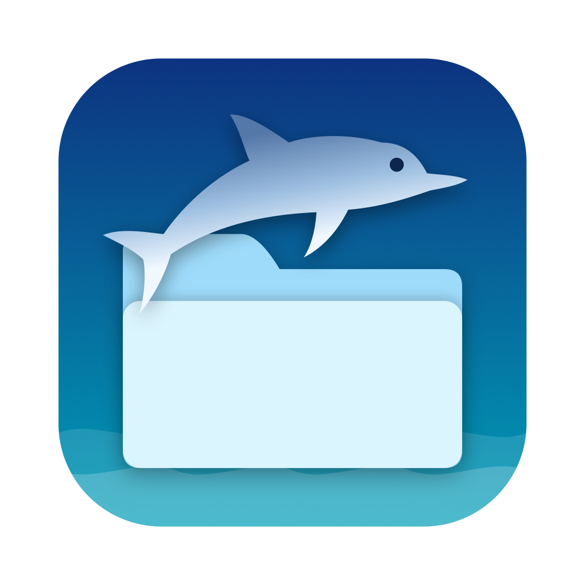

<p align="center">
  
</p>

<h1 align="center">Macphin</h1>

<p align="center">
  A Dolphin-style file manager for macOS. Free and open source.
</p>

<p align="center">
  <a href="https://github.com/saenai255/macphin/releases/latest">Download</a> ·
  <a href="#install">Install</a> ·
  <a href="#features">Features</a> ·
  <a href="#keyboard-shortcuts">Shortcuts</a>
</p>

---

Macphin is a native macOS file manager in Swift/SwiftUI, modeled on KDE's [Dolphin](https://github.com/KDE/dolphin): tabs, split panes, an editable Places panel, a breadcrumb location bar, an embedded terminal and git status badges.

> [!NOTE]
> Macphin is vibecoded: it was built largely with an AI coding assistant, so expect bugs and rough edges. [Issues](https://github.com/saenai255/macphin/issues) and [pull requests](https://github.com/saenai255/macphin/pulls) are very welcome.

## Install

### Homebrew

```bash
brew install --cask saenai255/tap/macphin
```

Update later with `brew upgrade --cask macphin`.

### Manual download

1. Download the latest `Macphin-x.y.z.dmg` from [Releases](https://github.com/saenai255/macphin/releases/latest).
2. Open it and drag **Macphin** into **Applications**.
3. Macphin isn't notarized by Apple, so macOS blocks it the first time. Clear the block with:

   ```bash
   xattr -dr com.apple.quarantine /Applications/Macphin.app
   ```

   Or open **System Settings → Privacy & Security**, scroll down and click **Open Anyway**.

Requires macOS 15 (Sequoia) or later, on Apple silicon or Intel.

### First launch

macOS asks before Macphin can read Desktop, Documents, Downloads, external drives and network volumes. To browse everything without prompts, grant **Full Disk Access** in **System Settings → Privacy & Security → Full Disk Access**.

## Features

- **Tabs**, each with its own optional **split view** (two panes side by side, F3)
- **Places panel** (F9): editable bookmarks (drag to reorder, "Add to Places", reset) plus mounted devices with eject
- **Breadcrumb location bar** with a subfolder menu on every segment; click empty space or press ⌘L to type a path (`~` supported)
- **View modes**: Icons (Quick Look thumbnails), Compact (column flow), Details (sortable table with optional Created, Permissions, Owner and Location columns; right-click the header) — ⌘1/⌘2/⌘3
- Icons and Compact use a native collection view: drag-a-box selection, multi-file drag, keyboard navigation, and type-to-select (start typing a name) in every view; folders with tens of thousands of files stay responsive
- **Git status badges** on files and folders inside repositories (modified, added, untracked, conflicted, ignored)
- **Zoom** slider in the status bar, plus ⌘+ / ⌘− / ⌘0
- **Information panel** (F11): preview, type, size (folder sizes computed recursively), dates, permissions, owner, image dimensions
- **Terminal panel** (F4): embedded shell (SwiftTerm) that follows the active folder
- **Filter bar** (⌥⌘F) and Spotlight-backed **search** scoped to the current folder (toolbar search field)
- File operations: cut/copy/paste, duplicate, inline rename (F2), new folder/file, move to trash, permanent delete, compress to zip, "Open With", copy/move to the other split pane
- **Undo/redo** (⌘Z / ⌘⇧Z) for move, copy, rename, trash, new folder/file, duplicate and compress. Permanent delete cannot be undone
- **Conflict dialog** when a copy or move hits existing names: Replace (old item goes to the Trash), Skip or Keep Both, with size and date comparison
- **Remote locations** (⌘K, the Network section in Places, or type a URL in the location bar): smb, afp, nfs, ftp and webdav(s) mount through macOS NetFS; sftp mounts through sshfs if macFUSE and sshfs are installed. Mounted servers appear under Devices with an eject button
- **Session restore**: windows, tabs, split panes and view modes come back on relaunch (toggle in Settings, ⌘,)
- **Progress panel** for copy, move, trash and delete with size, time left and a cancel button; copies clone instantly on APFS
- **Tabs** can be reordered by dragging, dragged onto another window's tab bar, or moved to a new window from the tab's context menu
- **Share** and your **Quick Actions** (Automator services) in the file context menu; free-space bars on drives in Places
- Drag and drop onto folders, breadcrumb segments, tabs, places, and Trash (⌥ forces copy; cross-volume drops copy)
- Quick Look with Space, show hidden files (⌘⇧.), folders-first sorting, live directory watching

## Using Macphin instead of Finder

With Macphin in /Applications, turn on **Settings → Use Macphin instead of Finder**. Folders opened from other apps, the Dock and `open` in Terminal then open in Macphin, and apps send "Show in Finder" here after they are relaunched. Finder itself keeps running because macOS needs it for the Desktop and Trash. Turning the setting off hands everything back to Finder. **Open Macphin at login** is in the same section.

## Keyboard shortcuts

| Action | Shortcut |
| --- | --- |
| New / close tab | ⌘T / ⌘W |
| Next / previous tab | ⌘⇧] / ⌘⇧[ |
| Split view / switch pane | F3 / ⌃⇧Tab |
| Places / terminal / information | F9 / F4 / F11 |
| Back / forward / up | ⌘[ / ⌘] / ⌘↑ |
| Open selection | Return or ⌘↓ |
| Edit location | ⌘L |
| Filter | ⌥⌘F |
| Rename | F2 |
| New folder / new text file | ⌘⇧N / ⌥⌘N |
| Move to trash / delete permanently | ⌘⌫ / ⌥⌘⌫ |
| Copy location | ⌥⌘C |
| Invert selection | ⌘⇧A |
| Show hidden files | ⌘⇧. |
| Reload | ⌘R |
| Undo / redo file operation | ⌘Z / ⌘⇧Z |
| Connect to server | ⌘K |

## Limitations

- Passwords typed in Connect to Server are not saved. smb/afp logins can be saved in the Keychain through the system login prompt.
- The undo history covers the current app run only, up to 100 steps.
- The tests move small temporary files to your Trash to exercise trash/undo.

## Uninstall

```bash
brew uninstall --cask macphin       # if installed with Homebrew
```

Otherwise, quit Macphin and move it from Applications to the Trash. If you turned on **Use Macphin instead of Finder**, turn it off first so folders open in Finder again.

## Building from source

See [docs/DEVELOPMENT.md](docs/DEVELOPMENT.md).

## License

[MIT](LICENSE). Macphin is inspired by KDE's Dolphin but is an independent project, not affiliated with KDE.
